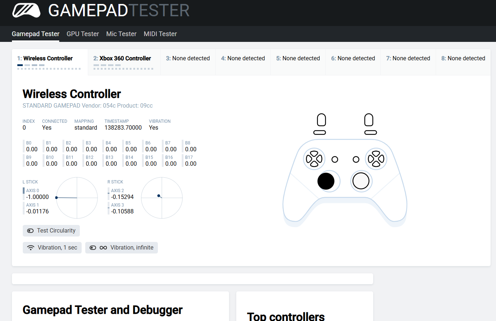
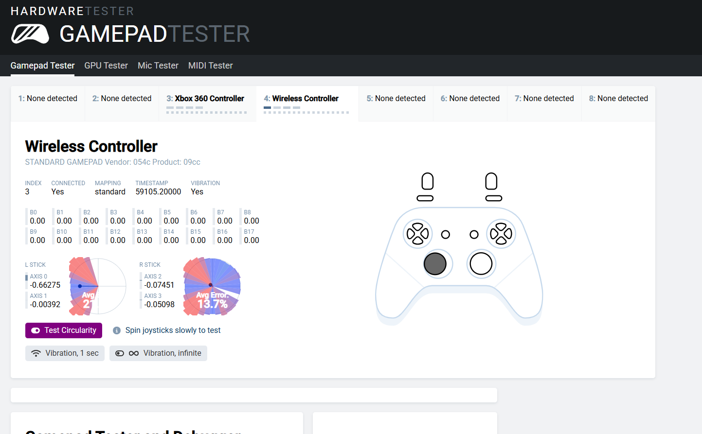
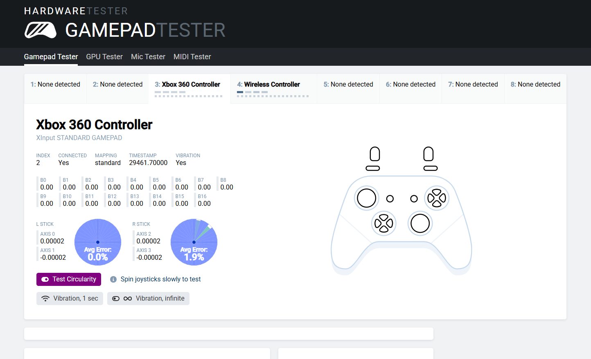
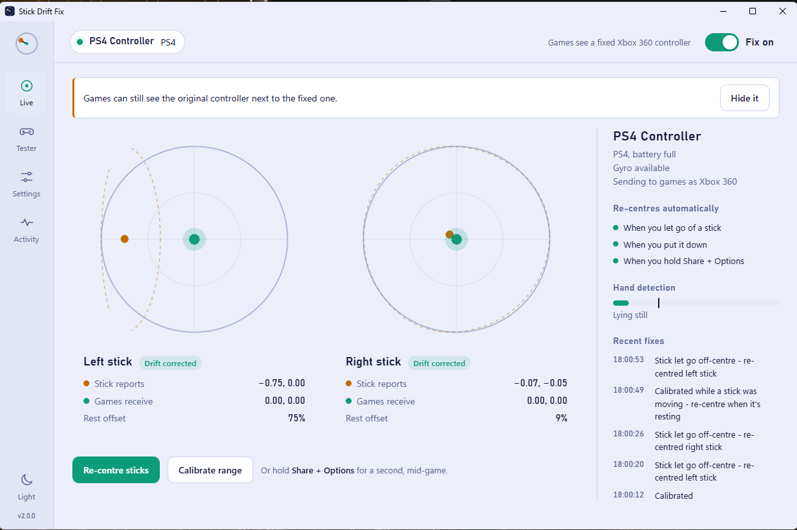
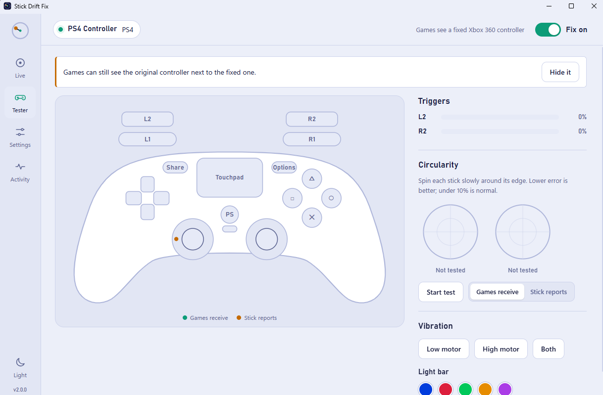
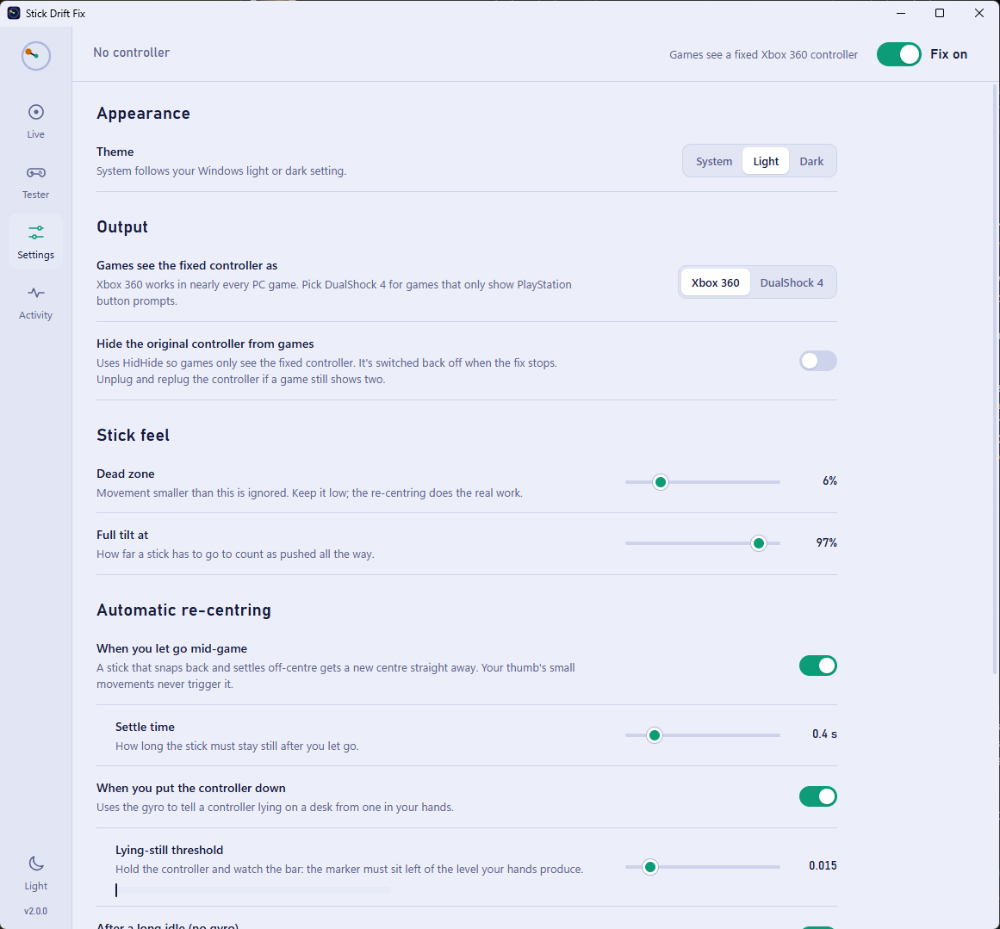
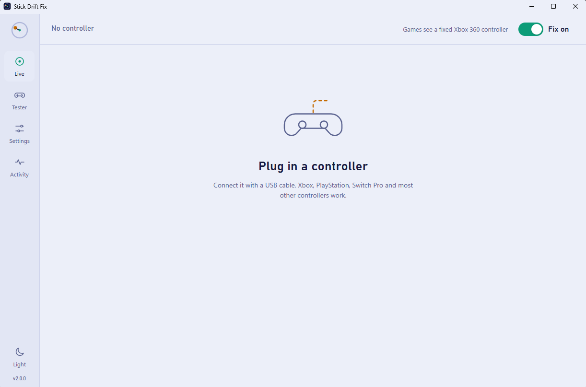

# Stick Drift Fix

Fix controller stick drift on Windows in software. No soldering, no new controller.

A dead zone can only hide small drift. Stick Drift Fix finds where each stick **actually** rests and how far it **actually** moves, then sends corrected input to games as a virtual controller. It works with Xbox, PlayStation (PS4/PS5), Switch Pro and most other controllers.

Tested on a clone DS4 whose left stick rested at **-0.67** and could only reach 40% of its travel to the right. After the fix it rests at **0.00** and draws a full circle.

## Results

| Before: left stick stuck left with no hands on it | Before: circularity test, most of the circle missing |
|---|---|
|  |  |

**After:** both sticks rest at 0.00, and the circularity error drops to 0.0% (left) and 1.9% (right).



## The app

| Live view: the left stick reports -0.75, games receive 0.00 | Controller tester |
|---|---|
|  |  |

| Settings | Waiting for a controller |
|---|---|
|  |  |

## Features

- **Live view:** see what the stick reports next to what games receive, with the learned range and rest point drawn in
- **Re-centres mid-game:** when you let go and the stick settles off-centre, it gets a new centre straight away. Your thumb's small movements never trigger it.
- **Re-centres when you put the controller down** (uses the gyro), or after a long idle on controllers without one
- **Manual re-centre:** hold Share + Options (View + Menu on Xbox) for a second, or press the button in the app
- **Range calibration:** worn sticks that can't reach the edge still give 100% output
- **Controller tester:** buttons, triggers, circularity test, vibration and light bar
- **Hides the original controller** from games through HidHide, so games only see the fixed one. It also checks that HidHide is really attached, and offers a one-click controller reset when it isn't.
- **Games only:** while the desktop, File Explorer, Start or another Windows app is in front, the fixed controller sends nothing, so it never moves your selection in Windows
- Xbox 360 or DualShock 4 output, light and dark themes

## Download

1. Install the [ViGEmBus](https://github.com/nefarius/ViGEmBus/releases) driver (already installed if you've used DS4Windows).
2. Recommended: install [HidHide](https://github.com/nefarius/HidHide/releases) so games don't see two controllers.
3. Download **StickDriftFix.exe** from [Releases](https://github.com/hunzalaqamar/DS4-stick-drift-fix/releases) and run it. It's portable: no install, keep it anywhere.

Windows may show "Windows protected your PC" because the exe isn't code-signed. Click **More info → Run anyway**.

## Usage

1. Close DS4Windows, DSX or other remapping tools. They make their own virtual controller.
2. Open Stick Drift Fix and plug in your controller by USB.
3. Leave the sticks alone for a second while it calibrates.
4. Worn stick? Click **Calibrate range** and spin both sticks around their edges.
5. In **Settings**, turn on **Hide the original controller from games**.
6. Keep the app open while you play.

Settings and calibration are saved in `%APPDATA%\StickDriftFix`.

## Troubleshooting

**Selections in Windows keep jumping left**
Windows has its own controller navigation (File Explorer, Alt+Tab, Snipping Tool), and it's reading the drifting stick. Unplugging the controller stops it. To fix it:
1. Close DS4Windows, DSX or similar tools (the app offers a button).
2. Turn on *Hide the original controller from games* in Settings (needs HidHide).
3. Still happening? HidHide can list the controller as hidden without being attached to it, and the app warns you when that happens. Click **Reset controller** in the warning, or go to Settings → *Reset controller connection*.

**What "Reset controller" does**
It restarts the controller in Windows: the same as *Disable* then *Enable* in Device Manager, or unplugging it. That gives HidHide a chance to attach. Before anything happens, the app shows exactly what will happen and the command it runs (`pnputil /restart-device "<controller id>"`). Windows then asks for admin approval, because restarting a device needs admin rights. The controller disconnects for a few seconds. Nothing is installed or changed permanently. If the warning stays after a reset, reinstall [HidHide](https://github.com/nefarius/HidHide/releases) and restart the PC.

**Games see two controllers**
Turn on *Hide the original controller from games* in Settings (needs HidHide), then unplug and replug the controller.

**A stick doesn't respond after starting**
It was moving or stuck during startup calibration. Click **Re-centre sticks**, or hold Share + Options for a second.

**The app re-centres while I'm holding a stick**
Settings → *When you let go mid-game* → raise the settle time, or turn it off.

**Auto re-centre fires while I'm holding the controller**
Settings → *Lying-still threshold*: hold the controller and move the marker left of where the bar sits.

**"ViGEmBus driver isn't installed"**
Install [ViGEmBus](https://github.com/nefarius/ViGEmBus/releases) and restart the app.

**Drift keeps getting worse**
Software can only use the range the sensor still has. Try cleaning the stick: push it to one side, spray compressed air or a drop of 90%+ isopropyl alcohol at its base, rotate it, and let it dry. If that doesn't help, replace the analog module.

Something else? Check `%APPDATA%\StickDriftFix\log.txt` and [open an issue](https://github.com/hunzalaqamar/DS4-stick-drift-fix/issues).

## Run from source

```bash
git clone https://github.com/hunzalaqamar/DS4-stick-drift-fix.git
cd DS4-stick-drift-fix
py -m pip install -r requirements.txt
py -m stickfix
```

Build the portable exe with `tools\build.bat` (output: `dist\StickDriftFix.exe`).

## How it works

SDL2 reads the controller (the same library Steam and many games use), the drift logic in `stickfix/drift.py` corrects the sticks, and ViGEmBus presents the result to games as a virtual Xbox 360 or DualShock 4 controller. Virtual controllers made by other tools are detected through the Windows device tree and ignored.

## License

MIT
